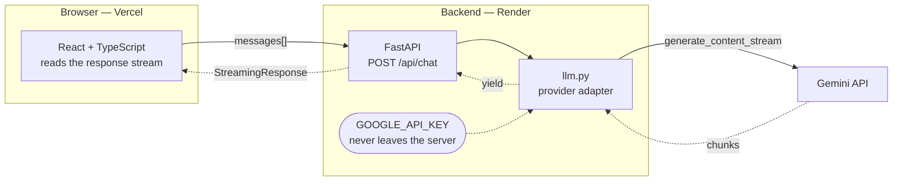

# doc-qa

Ask questions about your documents and get streamed answers with citations.

React + TypeScript frontend, FastAPI backend.

## Status
Phase 1 — streaming chat, in progress.

## Architecture

The browser never talks to Gemini directly. The API key can't exist in client
code — anyone could read it out of the bundle — so the backend exists to hold the
secret and proxy the call.

Responses stream end to end: Gemini yields chunks, `llm.py` passes them through a
generator, FastAPI wraps that in a `StreamingResponse`, and the client appends
them as it reads. A four-second answer starts appearing in about 200ms.

`llm.py` is a deliberate seam. Provider vocabulary differs — Gemini calls the AI's
turn `model`, OpenAI and Anthropic call it `assistant` — so the translation lives
in one file and the rest of the app is provider-agnostic. That paid off on day
one, when a model deprecation turned out to be a one-line fix.
